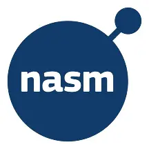

   

<strong>Program Analysis · Decompilation · Reverse Engineering</strong>

I work on low-level systems, reverse engineering, graphics, and machine learning.  
我主要开发底层系统、逆向工程、图形和机器学习相关项目。

## 📚 Projects / 项目

| Project / 项目 | Area / 领域 | Overview / 简介 |
| :--- | :--- | :--- |
| **[glslPerftEngine](https://github.com/Guacantaloupe/glslPerftEngine)**  | GPU Computing · Chess | An OpenGL compute-shader-based chess Perft program that counts legal move sequences on the GPU. It is not a complete chess AI. During development, I reported **NVIDIA GLSL compiler bug 6630275**, which NVIDIA confirmed and fixed.  使用 OpenGL 计算着色器，在 GPU 上统计国际象棋合法走法序列的 Perft 程序。它不是完整的国际象棋 AI。开发过程中，我报告了 NVIDIA GLSL 编译器错误 **6630275**，NVIDIA 已确认并修复。 |
| **[Reviewcentrifuge](https://github.com/Guacantaloupe/Reviewcentrifuge)**  | Reverse Engineering · Program Analysis | Selected core code from a closed-source reverse-engineering project, shared for architecture and code-quality review. The project includes SSA, MemorySSA, and symbolic execution for program analysis, with opaque-predicate analysis as a related application. This repository is not the complete project and cannot be built on its own.  一个闭源逆向工程项目的部分核心代码，用于架构和代码质量评审。项目包含 SSA、MemorySSA 和符号执行，用于程序分析；不透明谓词分析是相关应用方向。仓库不是完整项目，无法直接构建。 |
| **[ReviewUefiVmxAppPkg](https://github.com/Guacantaloupe/ReviewUefiVmxAppPkg)**  | UEFI · Virtualization | Selected C source code from a UEFI and Intel VMX project for code review, covering VMX initialization, memory mapping, nested virtualization, and Windows boot loading. This repository is incomplete and cannot be built on its own.  用于代码评审的 UEFI 和 Intel VMX 项目部分 C 源码，涉及 VMX 初始化、内存映射、嵌套虚拟化和 Windows 启动加载。仓库不是完整项目，无法直接构建。 |
| **[paper](https://github.com/Guacantaloupe/paper)**  | Static Analysis · MCP | A Windows executable static-analysis tool with disassembly, function analysis, control-flow graphs, and cross-references. It also provides MCP tools for AI clients.  用于 Windows 可执行文件静态分析的程序。支持反汇编、函数分析、控制流图和交叉引用，也提供供 AI 客户端通过 MCP 调用的工具。 |
| **[imgui-overlay](https://github.com/Guacantaloupe/imgui-overlay)**  | Graphics · API Hooking | A Dear ImGui-based overlay project with graphics API hooking code for DirectX 11, DirectX 12, OpenGL, and Vulkan.  基于 Dear ImGui 的覆盖层项目，包含 DirectX 11、DirectX 12、OpenGL 和 Vulkan 的图形 API Hook 代码。 |
| **[guadbg](https://github.com/Guacantaloupe/guadbg)**  | Windows Debugging · MCP | An experimental Windows debugger based on vectored exception handling (VEH), with breakpoints, memory inspection, an ImGui interface, and MCP tools.  基于向量化异常处理（VEH）的实验性 Windows 调试器，支持断点、内存查看、ImGui 界面和 MCP 工具。 |

## Related technologies / 相关技术

| Technology / 技术 | Reference / 相关链接 |
| :--- | :--- |
| **UEFI** |  |
| **NASM** |  |
